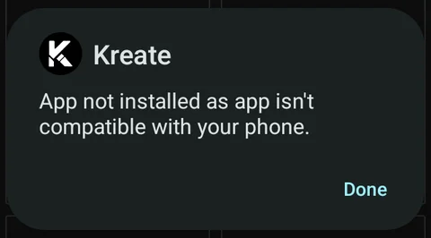
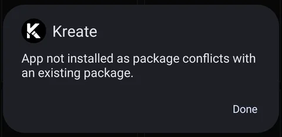

Each Kreate release on GitHub comes with several APKs. They are the same app, built for different
phones.

## The files

| File | Build | For |
| --- | --- | --- |
| `kreate-universal.apk` | GitHub | Every phone |
| `kreate-arm64.apk` | GitHub | 64-bit ARM phones (most phones) |
| `kreate-armv7.apk` | GitHub | 32-bit ARM phones (older or low-end phones) |
| `kreate-x86_64.apk` | GitHub | 64-bit Intel/AMD devices |
| `kreate-x86.apk` | GitHub | 32-bit Intel/AMD devices |
| `kreate-foss.apk` | FOSS | Every phone |

The Patreon build comes in the same five variants (universal plus four CPU types) and is downloaded
from Patreon. See [Choosing your build](/usr/choosing-your-build) for how the GitHub, FOSS and
Patreon builds differ.

## Why build for each CPU?

Kreate is written in Kotlin, but some of the libraries it uses contain native code: code compiled
directly for a phone's processor. Native code has to be compiled separately for each type of
processor (each *ABI*), so an app that runs everywhere has to carry one copy for each.

Your phone only ever uses one of those copies. A CPU-specific APK carries only the copy for one
type of processor, so it is a smaller download and takes less space once installed.

## Which one should I download?

**If you are not sure, download `kreate-universal.apk`.** It works on every phone.

If you want the smaller file, pick the one for your phone's processor:

- Almost every phone from the last several years is **64-bit ARM**: `kreate-arm64.apk`.
- Some older or low-end phones are **32-bit ARM**: `kreate-armv7.apk`.
- **x86** files are for Chromebooks, emulators and a few older Intel tablets.

To check, install a hardware info app such as CPU-Z and look for the instruction set, or ABI. You
can also drop an APK onto the [verify page](/verify), which shows the CPU types the file supports.

A CPU-specific APK won't install on a phone with a different processor. Android refuses it with
an error like this one, here from installing `kreate-x86_64.apk` on an ARM phone:

If you see it, download `kreate-universal.apk` or the APK for your phone's processor instead.

## Can I switch between them?

Yes. All the GitHub APKs are the same app with the same signature, so you can install one over
another, for example to move from `kreate-universal.apk` to `kreate-arm64.apk`. Your library and
settings are kept.

Moving between the GitHub, FOSS and Patreon builds is different. If the installed build is signed
with a different key, Android refuses the new APK:

See [Switching between builds](/usr/choosing-your-build#switching-between-builds) for how to move
without losing your library.

## What about F-Droid and IzzyOnDroid?

They ship `kreate-foss.apk`. Your store installs and updates it for you, so there is no file to
pick.
