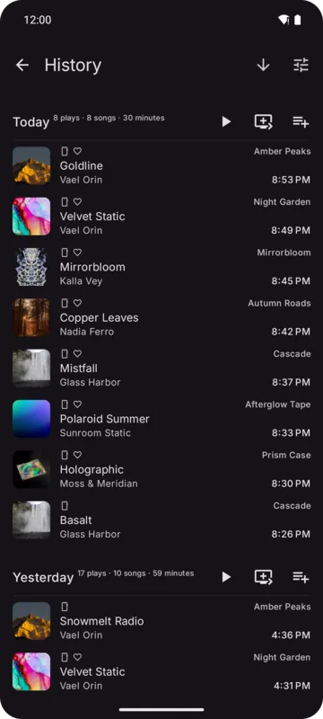

Kreate records every song you play, on your device. Open it from **Account → History**.

A play counts once it reaches the **Minimum play time** (1 second by default; pauses and loading
don't count). **Pause history** stops recording. Both are under **Settings → Player → History**.
While history is paused the page says so, with a **Resume** button.

## The list

Plays are grouped: **Today**, **Yesterday**, the days of the past week, then weeks, months and
years. Each group's header shows how many songs and how much time it holds, plus **Play**,
**Play next** and **Add to queue** for that group.

- Tap a play to play from there on in its group.
- A play's menu has **Delete from history**.
- The button in the bar flips between newest and oldest first.

## Filters and actions

The settings button opens a sheet:

- **Play all**, **Play next**, **Add to queue**, **Shuffle**
- **Clear history**: asks first. With filters on, only the plays shown are removed.
- **Source** chips
- **Date range**: presets (Today, Last 7 days, Last 30 days, This year, All time) or any range
  from the calendar

Filters apply at once and reset when you leave the page.

Files opened from other apps aren't recorded.
