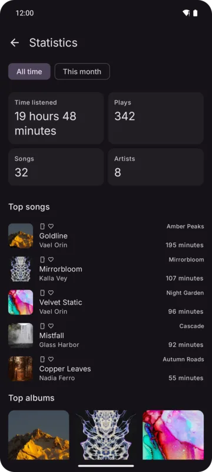

**Account → Statistics** turns your [history](./history.md) into numbers and charts. Everything is
worked out on your device.

## Overview

Choose **All time** or **This month**.

- **Summary tiles**: Time listened, Plays, Songs and Artists. *This month* compares each with last
  month up to the same day.
- **Top songs** (5), with minutes listened.
- **Top albums** (3).
- **Top artists** (10), as columns under their pictures, the first one crowned.
- **Listening by source**: a donut of time per source.

## Song, album and artist statistics

Tap a song, album or artist in the overview, or use **Statistics** in an album or artist page's ⋮
menu. All of these cover all time:

- the item's numbers: Plays, Times completed, Time listened, First discovered, Last played, and
  for albums and artists Songs played; the header opens the item's page;
- **Listening over time**, **By hour of the day**, **By day of the week** charts (tap a column to
  see its value);
- for albums and artists, their top 10 songs.
