**Settings → Backup** saves everything to one file, and puts it back.

## What a backup holds

- Every profile and its settings
- The library: songs, albums, artists, playlists, likes and dislikes, history, your edits
- Pictures you chose for playlists, songs, albums and artists
- Fonts you picked

**Not included**: passwords, API keys and sign-ins. They stay on this device. Downloaded and cached
songs aren't included either.

## Back up

Tap **Back up** and choose where to save the file (named like
`kreate_backup_<version>_<date>_<time>.zip`). The row shows *Saving…* and then
*Backup saved*.

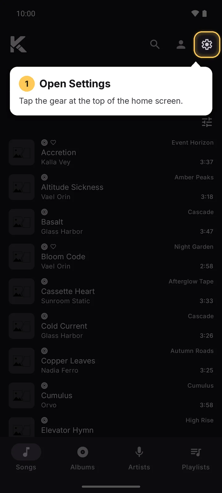
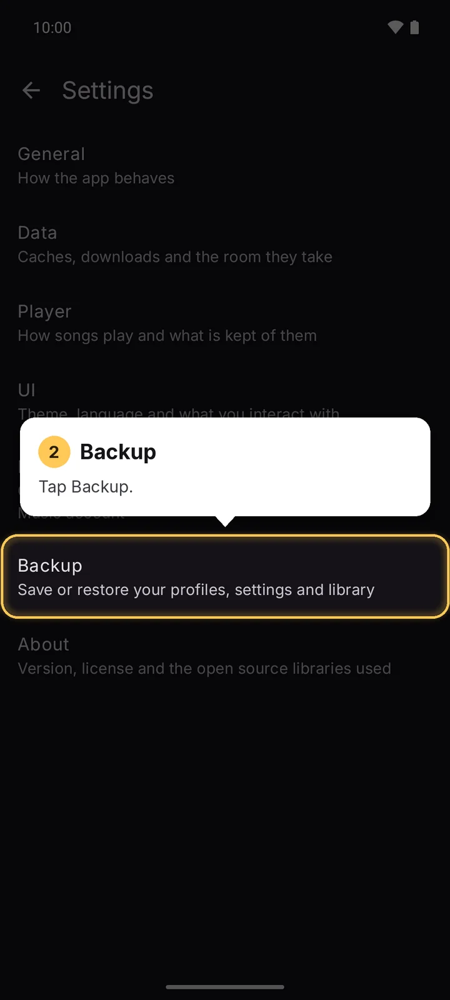
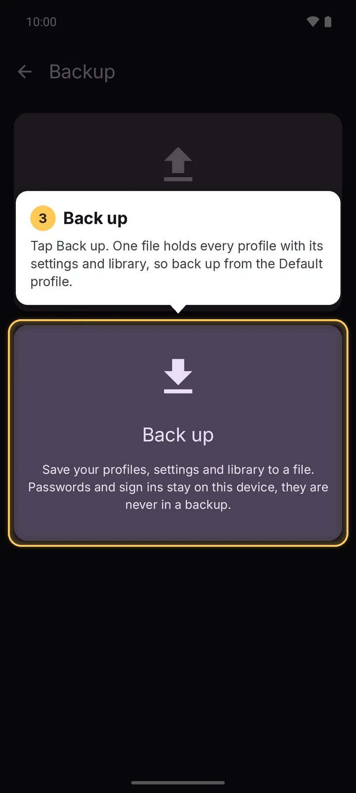
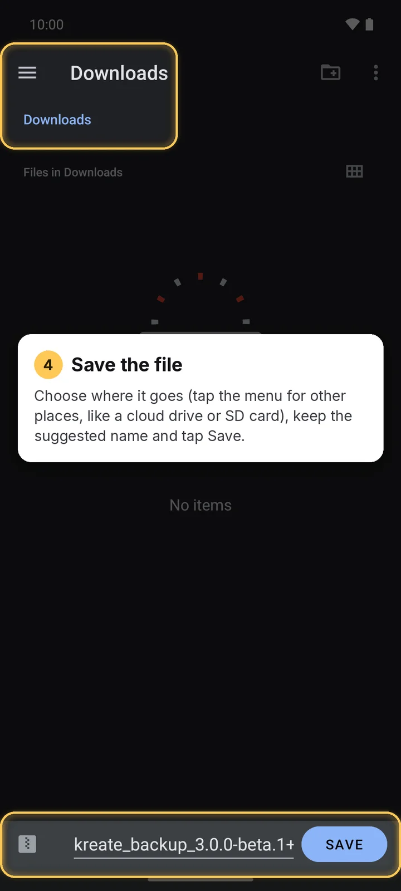
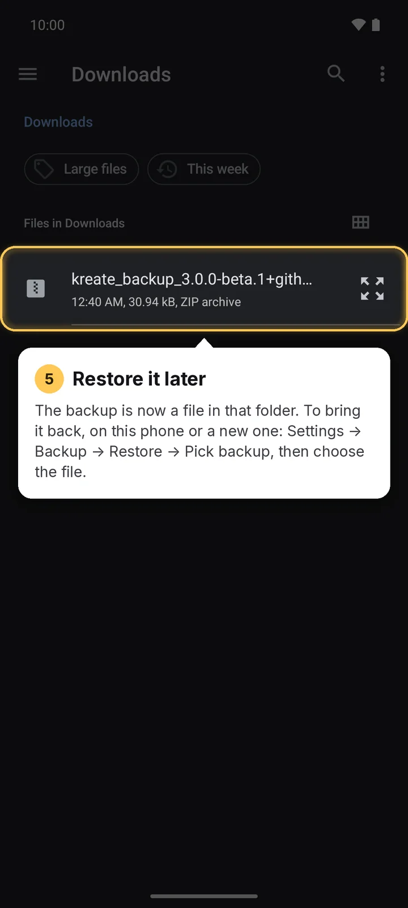

To keep the backup safe from losing your phone, save it to a cloud drive or SD card: in step 4,
open the menu for other places.

## Restore

Tap **Restore** and choose a backup. It **replaces everything**: every profile, setting and the
library. The app restarts once it's done.

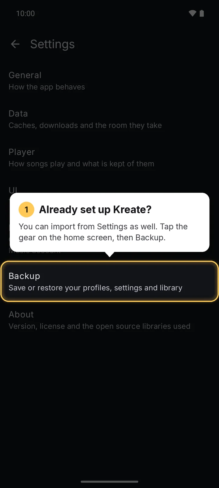
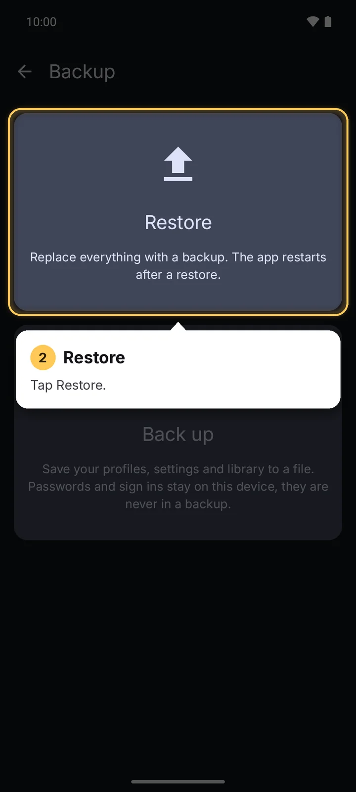
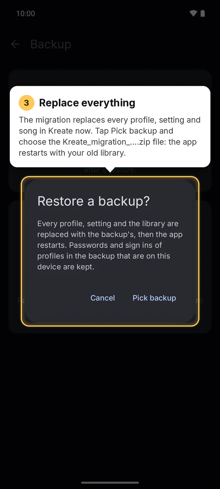
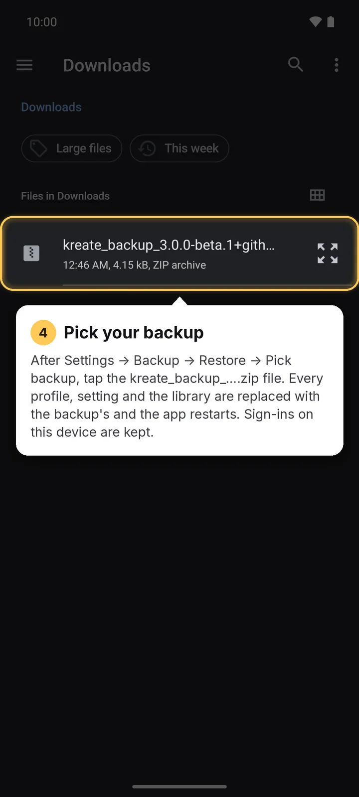

Sign-ins of profiles that exist both on this device and in the backup are kept.

If the restore fails, Kreate puts back what you had before.

:::note
Backup and restore are only available on the **default profile**.
:::

## During setup

The setup wizard's **Import** page restores a backup too, so a new device starts with your library
and settings. See [First launch](../../Getting-started/first-launch.md#3-import).

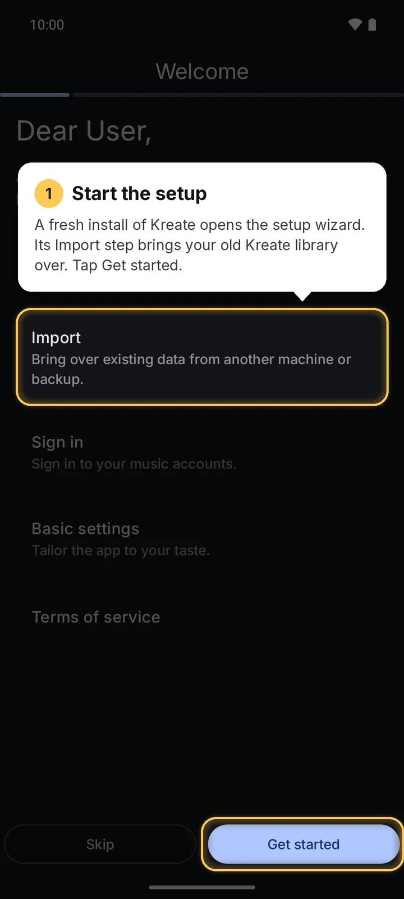
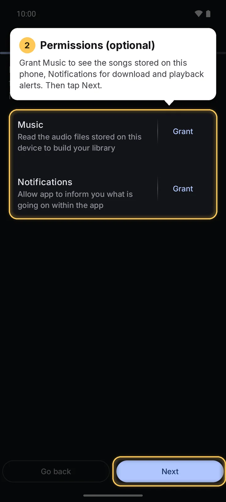
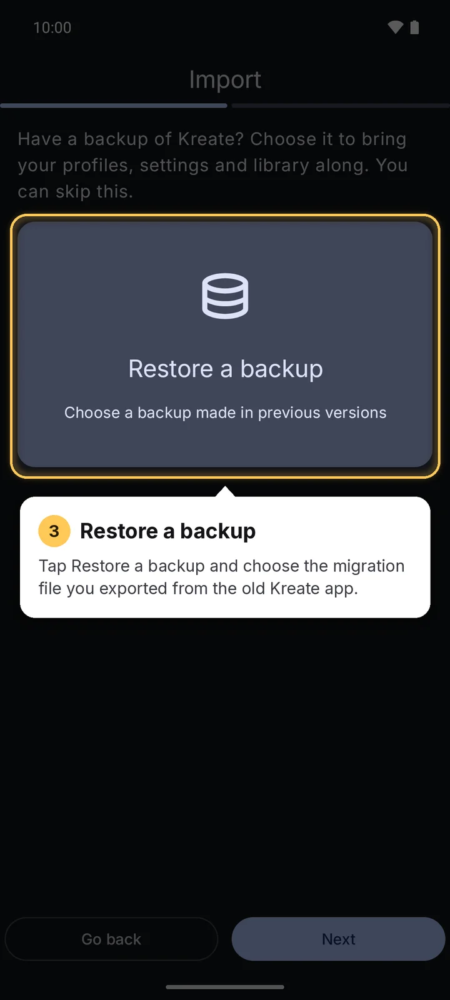

Finish the rest of the wizard as usual; the backup is restored when you tap **Start listening**.

## Older backups

A backup from an older version of Kreate can be restored by a newer version; a backup made by a
newer version than the one installed is refused, so update Kreate first. The
**old Kreate app's** export is also accepted: see
[Import from the old app](./import-from-old-kreate.md).
