Kreate can take over the library of the old Kreate app.

## Steps

1. In the old app, export your data as one zip file (named like `Kreate_migration_….zip`).
2. In Kreate, choose that file, either [during setup](#during-setup) or
   [from Settings](#from-settings). The same Restore button handles both Kreate backups and the
   old app's export.

### During setup

A fresh install of Kreate opens the setup wizard. Its **Import** step brings your old library over.

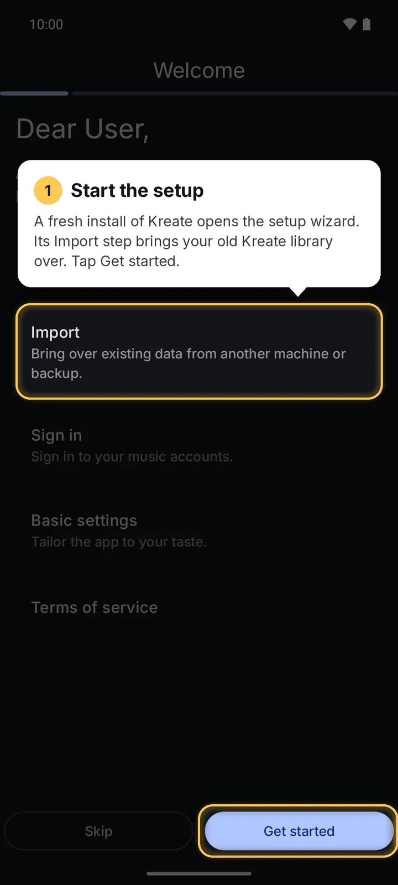
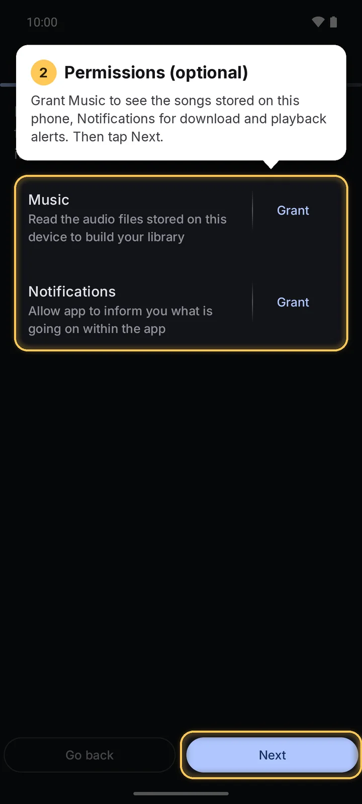
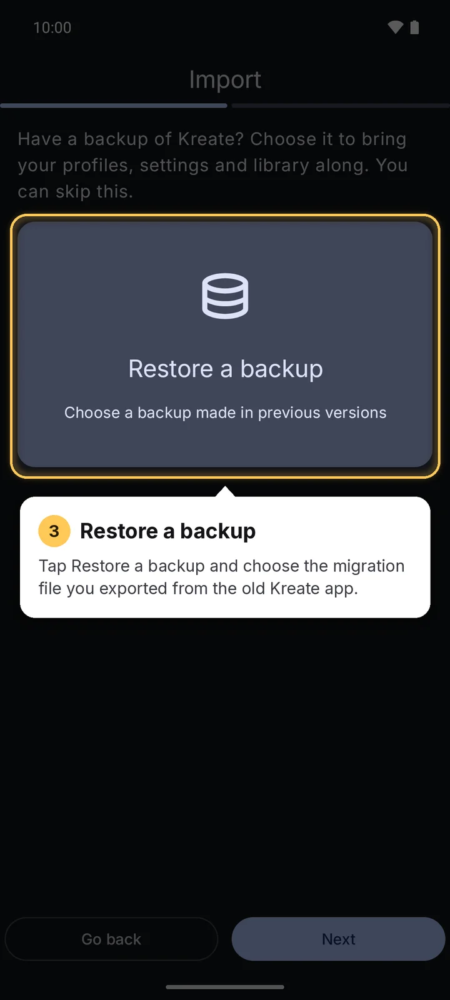
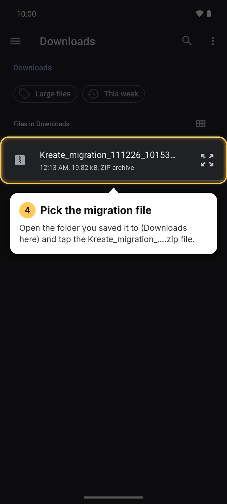
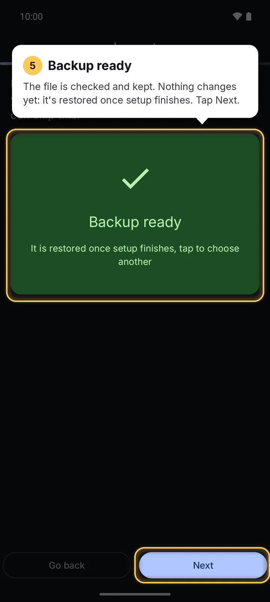
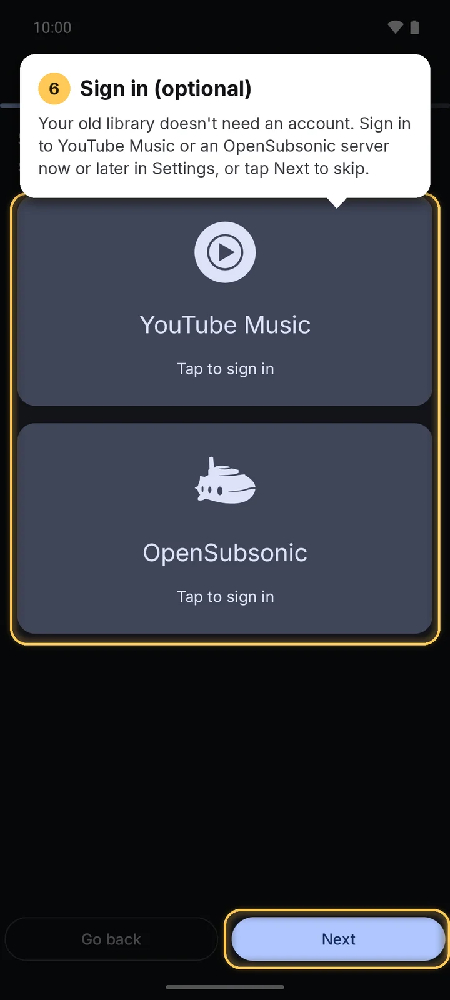
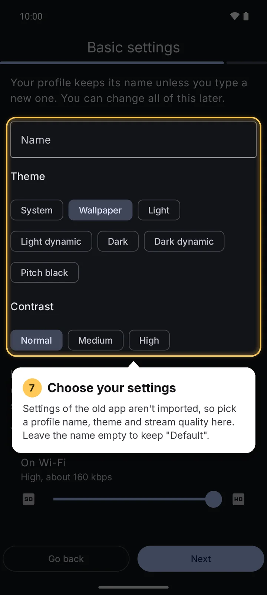
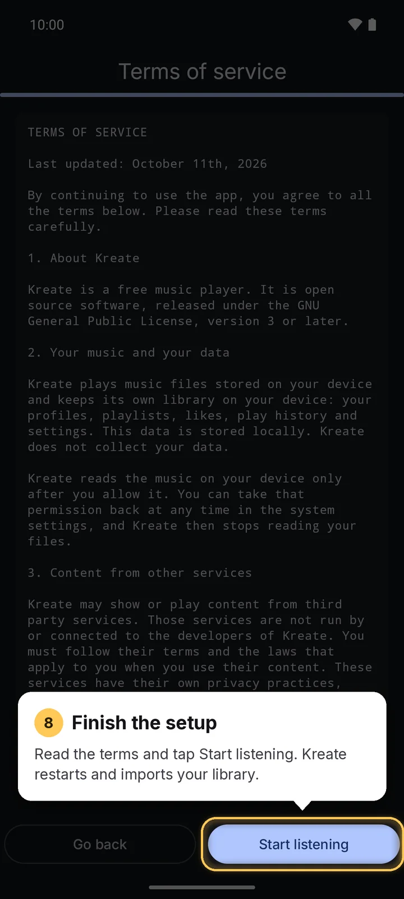

The old app's settings aren't imported, so step 7 is where you pick a profile name, theme and
stream quality. Leave the name empty to keep *Default*.

### From Settings

Already set up Kreate? Import from **Settings → Backup → Restore** instead.

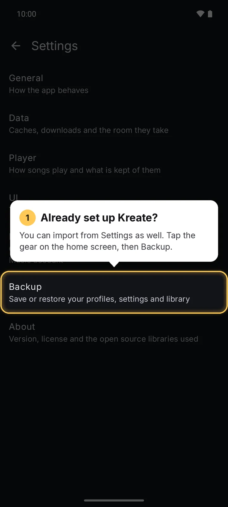
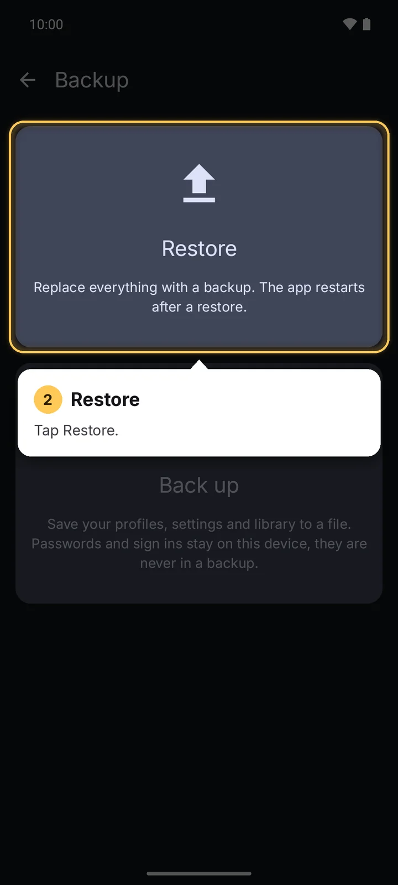
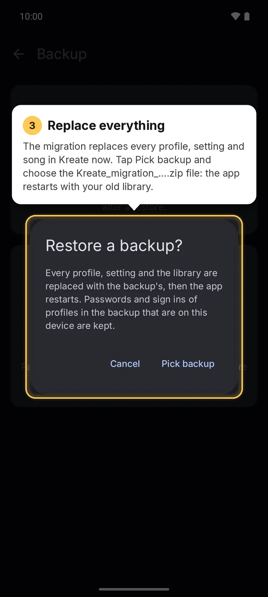

The import replaces every profile, setting and song in Kreate. The app then restarts with your old
library.

## What comes over

| Brought over | Notes |
|--------------|-------|
| Profiles | The first one stays the default profile, named *Default* |
| Songs, albums, artists | |
| Likes and dislikes | |
| Listening history | |
| Playlists | As local playlists; unnamed ones become *Playlist-1*, *Playlist-2*…; monthly playlists stay monthly |

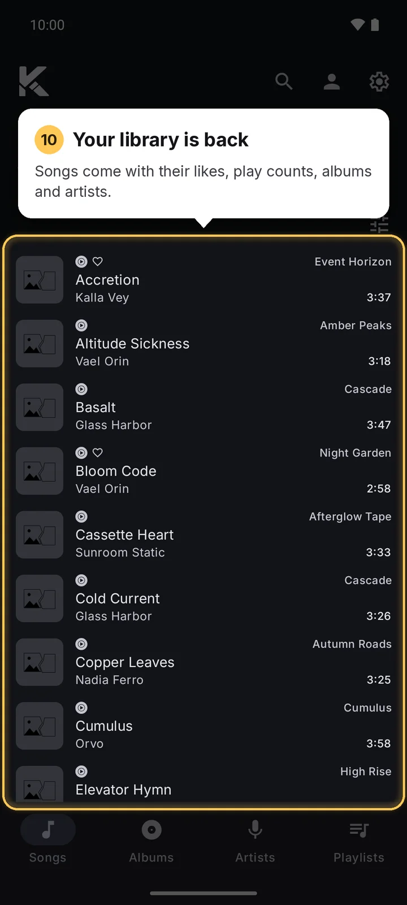
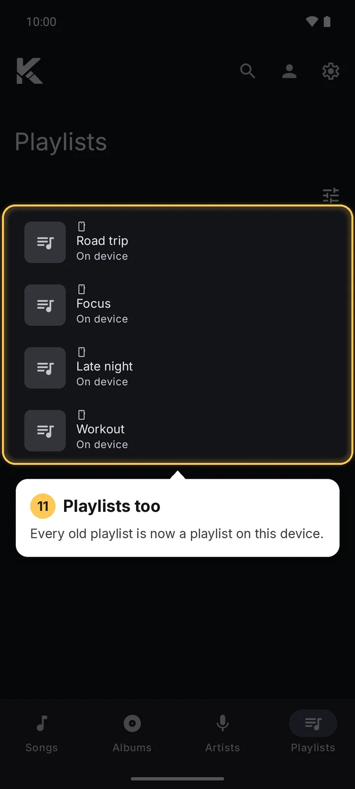

**Not brought over**: the old app's settings, lyrics, saved queue and device songs (the
[local scan](../sources/local-files.md) finds those again).

Like any restore, the import **replaces everything** in Kreate.

## Old downloads

Downloaded files aren't moved; the songs are downloaded again. After the import, Kreate asks about
the songs the old app had downloaded:

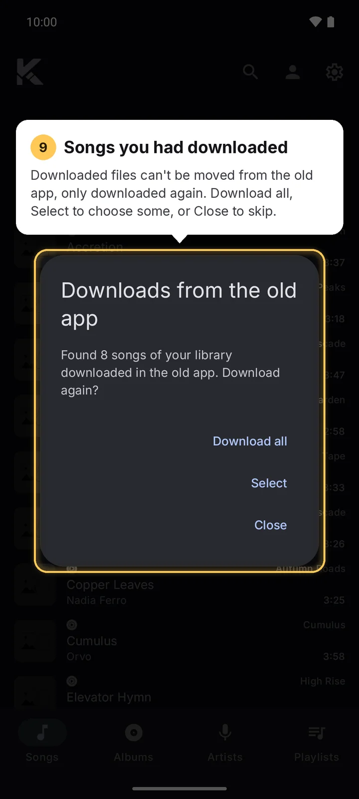

| Choice | What happens |
|--------|--------------|
| **Download all** | Downloads every one of them |
| **Select** | Opens a list to pick from; **Select all** and **Clear all** help. Leaving the list downloads the songs you picked (none is fine). |
| **Close** | Downloads nothing |

Songs that can't be found anymore are left out of the list.
