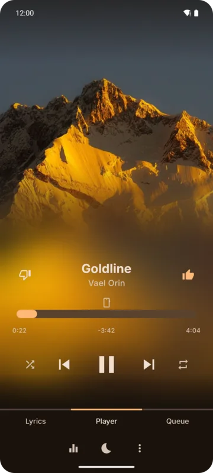
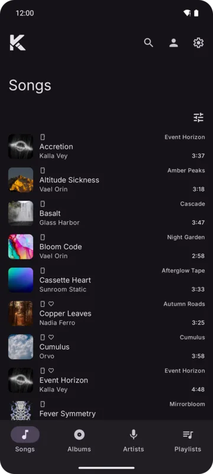
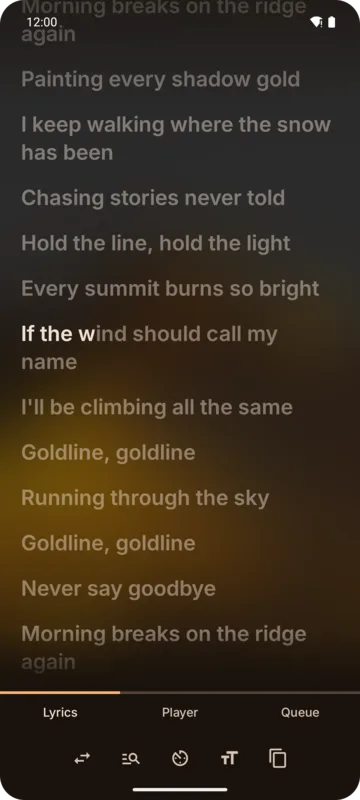

Kreate is a music player for Android that puts three kinds of music in **one library**:

- **Music files on your device**, found by a background scan.
- **YouTube Music**, with or without signing in.
- **Your own OpenSubsonic server**, such as Navidrome.

Songs from every source sit side by side in the same lists, play in the same queue and count
toward the same history and statistics.

  

## What Kreate does

| Area | Highlights |
|------|------------|
| [Library](./library/home.md) | Songs, Albums, Artists and Playlists tabs, filters by source, search across sources |
| [Playlists](./library/playlists.md) | Playlists on the device, on YouTube Music and on your server; reorder, remove, edit, delete |
| [Player](./playback/player.md) | Full player with Player, Lyrics and Queue pages; shuffle, repeat, play next, radio |
| [Lyrics](./playback/lyrics.md) | Synced lyrics, word by word when the source has them, from four sources |
| [Loudness](./playback/loudness.md) | Evens out the volume, using your server's ReplayGain and measuring local files |
| [Sleep timer](./playback/sleep-timer.md) | Minutes or end of song, controllable from its notification |
| [Downloads](./offline/downloads.md) | Download songs for offline listening; streamed songs are cached |
| [History and statistics](./account/statistics.md) | Every play kept on the device, with charts and top lists |
| [Profiles](./account/profiles.md) | Each profile has its own library and settings |
| [Android Auto](./integrations/android-auto.md) | Browse your library and use voice search in the car |
| [Backup](./backup/backup-and-restore.md) | Save everything to one file; import from the old Kreate app |

## Privacy

Your history, statistics, likes and settings are kept **on your device**. Passwords and sign-ins
never leave the device, not even in a backup.

## License

Kreate is free software under the **GNU General Public License v3.0 or later**. The source code
is on GitHub; **Settings → About** links to it and to the issue tracker.

:::note
Kreate is not affiliated with, funded, authorized or endorsed by YouTube, Google LLC or any of
their affiliates.
:::
