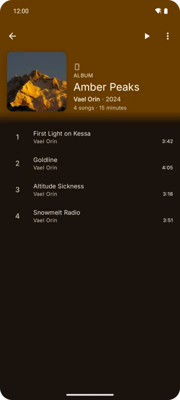
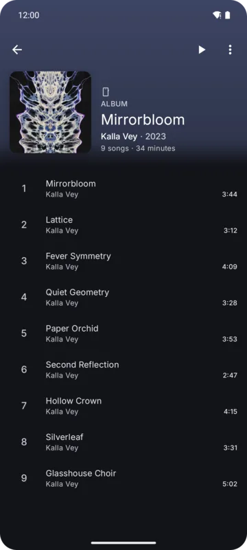
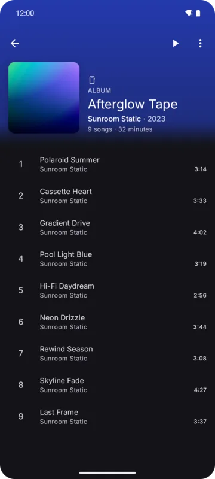
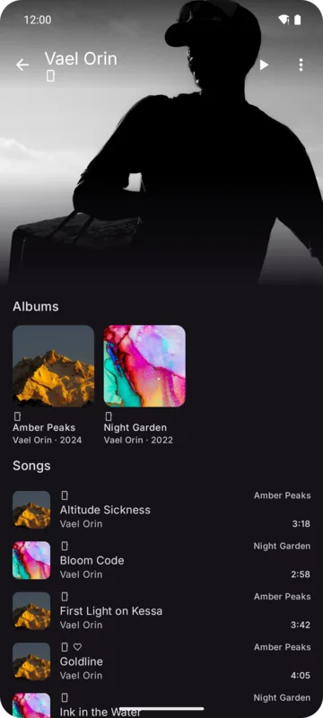
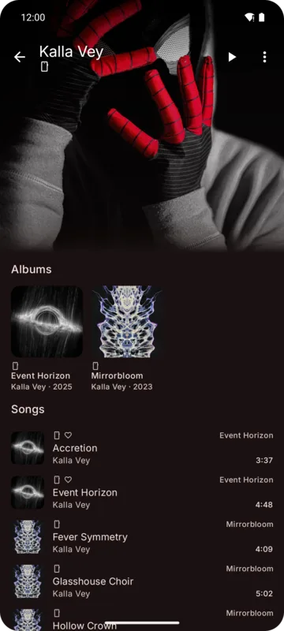
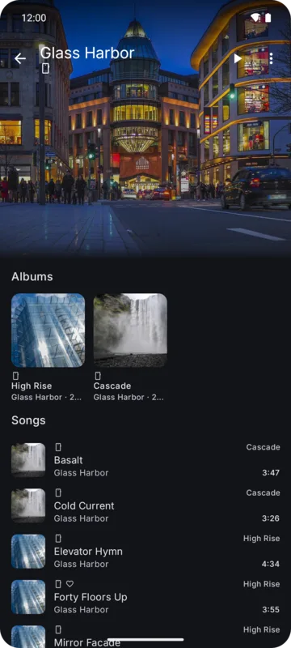

## Album page

The header takes its color from the album cover and shows the cover, name, artist, song count,
total length and description. Tap the artist line to open the artist. Scrolling shrinks the header
into the top bar.

  

- The **page button** before ⋮ plays, shuffles, plays next or adds the album to the queue. Pick
  which under **Settings → General → Albums → Page button** (default Play).
- **Bookmark** keeps the album: on YouTube Music it's saved to your library (when signed in), on a
  server it's starred, otherwise it's kept on the device. **Bookmarked only** on the Albums tab
  shows these.
- Tracks are numbered by position.

### Reordering a device album

Device albums can be put in your own order: ⋮ → **Reorder**, then drag the handles. Long press
**Reorder** to go back to the album's own order.

## Artist page

The artist's picture fills the top of the page and blurs as you scroll. The top bar shows the name
and, for YouTube Music artists, the monthly audience.

  

Sections depend on the source: top songs, albums, singles and more. **See more** opens the full
list. A server artist's **See more** lists every song by the artist; **Play** and **Shuffle** there
start at once while the rest loads.

- The **page button** before ⋮: **Settings → General → Artists → Page button** (default Play).
- **Follow**: subscribes on YouTube Music (signed in), stars on a server, otherwise kept on the
  device. **Followed only** on the Artists tab shows these.

## Opening animations

Albums and artists grow out of the card you tapped, with the card's picture standing in until the
full-size one loads.

## Bookmark and follow failures

A bookmark or follow flips at once. If the source refuses it, it flips back and a message tells
you why.
