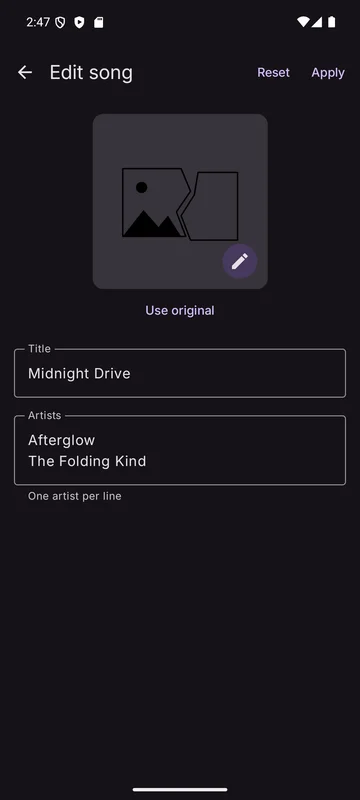
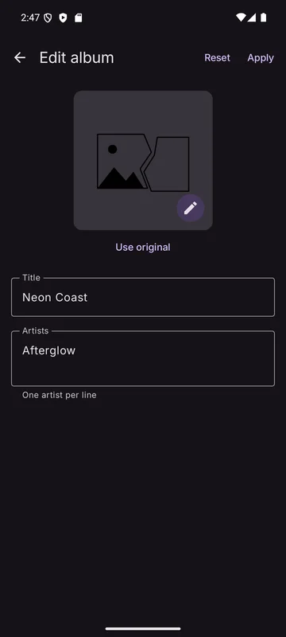
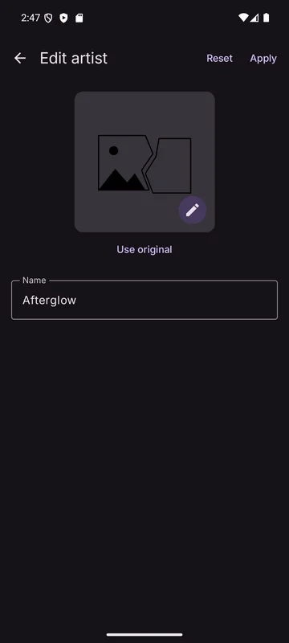

You can give any song, album or artist your **own** title or name, artists and picture. Your
changes apply only to your profile and never change the source.

Open **Edit** from:

- a song's menu,
- the ⋮ menu of an album or artist page,
- the long-press menu of an album or artist.

## Fields

  

| Field | Notes |
|-------|-------|
| **Title** / **Name** | |
| **Artists** | One artist per line (songs and albums) |
| **Picture** | Tap the pencil over the picture to choose an image from your device |

Each field has **Use original** to go back to the source's value.

The top bar has **Reset** (drop your unsaved changes) and **Apply**. Leaving with unsaved changes
asks first.

## Items you haven't kept yet

Editing a YouTube Music or server item that isn't in your library yet fetches it when the screen
opens. It's stored, with your changes, only when you tap **Apply**.

## Backups

Pictures you chose are included in [backups](../backup/backup-and-restore.md).
