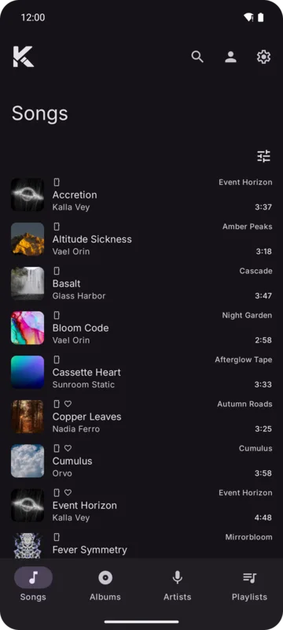
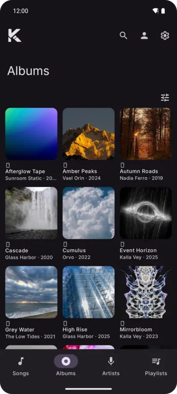
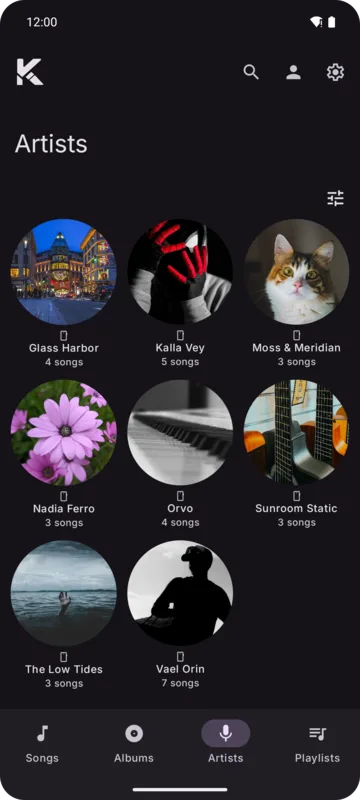
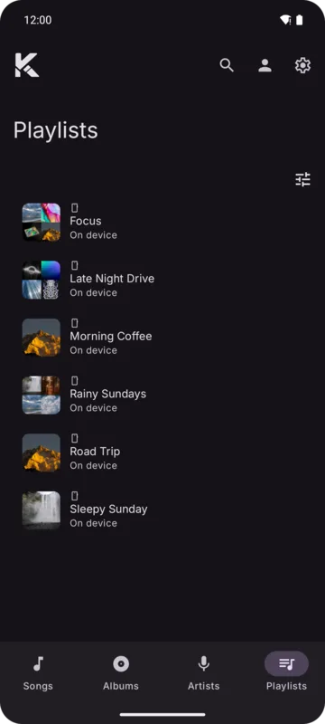

The main screen has four tabs: **Songs**, **Albums**, **Artists** and **Playlists**. Each shows your
library from every source together.

   

## Source chips

Under the title, chips filter the tab by source (Device, YouTube Music, OpenSubsonic). Only sources
the tab has items from are offered. Your choice is kept per tab.

## Pull to refresh

Pull down on a tab to fetch its live items again. On **Songs**, pulling also syncs your liked songs
from YouTube Music and your server right away, even if they were synced a moment ago. Tabs that
only show device items don't pull.

## The tab's sheet

The settings button in each tab's toolbar opens a sheet of actions and filters.

### Songs

| Item | What it does |
|------|--------------|
| **Play all**, **Shuffle**, **Play next**, **Add to queue** | Act on the songs shown |
| **Show disliked** | Shows songs you disliked, which are hidden by default |
| **Cached only** | Only songs in the song cache |
| **Downloaded only** | Only downloaded songs |

Tapping a song plays the list from that song. With **Settings → Player → Queue → Radio from Songs**
on, a tapped song plays with songs like it instead.

### Albums

| Item | What it does |
|------|--------------|
| **Open random** | Opens a random album |
| **Play random** | Plays a random album |
| **Bookmarked only** | Only albums you bookmarked |

### Artists

| Item | What it does |
|------|--------------|
| **Open random** | Opens a random artist |
| **Followed only** | Only artists you follow |

### Playlists

| Item | What it does |
|------|--------------|
| **Open random**, **Play random** | A random playlist |
| **New playlist** | Opens [New playlist](./playlists.md#creating-a-playlist) |
| **Monthly only** | Only monthly playlists (offered when you have some, for example from the [old app](../backup/import-from-old-kreate.md)) |

Pinned playlists come first.

Filters stay while you move around the app and reset when the tab is closed.
