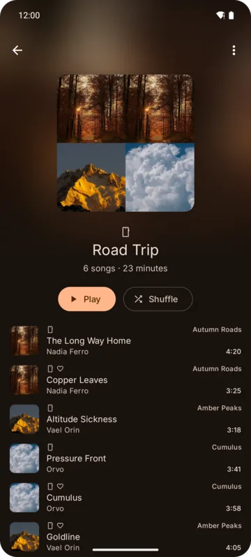
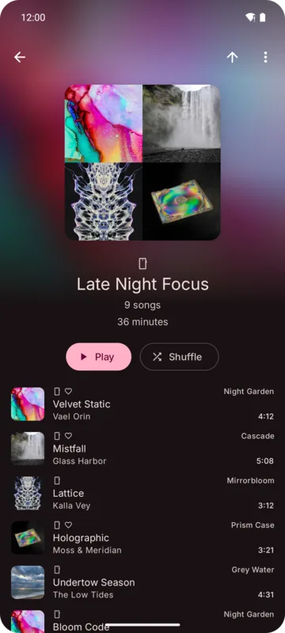
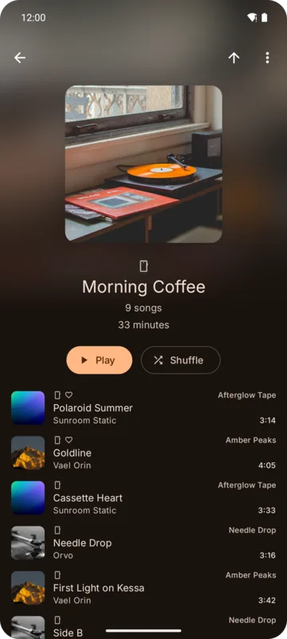

Kreate handles three kinds of playlists:

| Kind | Where it lives | What you can do |
|------|----------------|-----------------|
| **Local** | On the device, in your profile | Everything: add, move, remove, rename, pin, picture, delete |
| **YouTube Music** | Your account | Add, move, remove, rename, description, who can see it, delete (your own playlists) |
| **OpenSubsonic** | Your server | Add, move, remove, rename, description, public, delete |

A local playlist can hold songs from every source.

## Creating a playlist

Tap **New playlist** in the Playlists tab's sheet, or the create button in **Add to playlist**.
The bottom bar has one page per place a playlist can be made:

- **Local** (default): name, and **Pin to the top**.
- **YouTube Music** (signed in): name, description and **Who can see it** (Public, Anyone with
  the link, Private).
- **OpenSubsonic** (signed in): name, description and **Public** (other users of the server can see
  it).

Sources that are off or signed out have no page. When you create a playlist for a song, only
Local and the song's own source are offered.

## The playlist page

The header shows the playlist's picture, or a grid of its first four song covers, over a blurred
copy. Under it: source badge, name, owner, song count and length, and two buttons.

  

- **The two buttons** are chosen under **Settings → General → Playlists**: **First button**
  (default Play) and **Second button** (default Shuffle), from Play, Shuffle, Play next, Add to
  queue and Share. Share is hidden on local playlists.
- **Order button** (before ⋮): flips the playlist, newest songs first or last. One setting for all
  local and server playlists; not available on YouTube Music playlists.
- The page takes its colors from the playlist's picture, else its first song's cover.

## Moving and removing songs

Turn on the **move** or **remove** switch in the ⋮ menu. Covers become drag handles or remove
buttons. A removed song shows a message naming it, with **Undo**.

### Local playlists

Each move and removal is saved at once.

### Server and YouTube Music playlists

Changes are made on the page first and **sent together** when you turn the switch off. Leaving with
unsent changes asks: **Save changes**, **Discard changes** or **Close**. If saving fails, the
playlist keeps the server's order.

YouTube Music playlists are fully loaded before editing starts, which can take a few seconds for
long playlists. Playlists you can't change show their rows grayed out.

## Editing details

⋮ → **Edit**:

- **Local**: name, **Pin to the top** and a picture from your device (tap the pencil over the
  picture). **Reset** drops your changes; **Apply** saves them.
- **YouTube Music / OpenSubsonic**: name, description and visibility, sent to the source on
  **Apply**. The picture is shown but can't be changed.

## Deleting a playlist

⋮ → **Delete playlist** asks first. The songs stay in your library. For server and YouTube Music
playlists Kreate waits for the source to confirm.

## Monthly playlists

Playlists marked monthly (brought over from the [old Kreate app](../backup/import-from-old-kreate.md))
can be listed alone with **Monthly only**. Songs can't be removed from them, but they can be
deleted.

## Playlist initial

With **Settings → UI → Layout → Playlist initial** on, playlists without a cover show the first
letter of their name instead of an icon.
