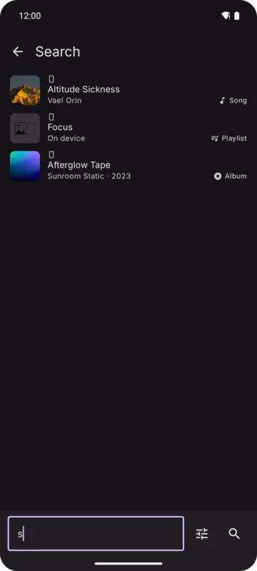

Search looks in **one source at a time**: your library, YouTube Music or your OpenSubsonic server.
The hint in the search field says which one (*Search your library*, *Search YouTube Music*…).

## Choosing what to search

The settings button opens a sheet:

- **Source**: slide between **Local** (your library), **YouTube Music** and **OpenSubsonic**.
  OpenSubsonic is offered while its source is on. Kreate remembers the last source.
- **Look for**: chips for **Songs**, **Albums**, **Artists** and **Playlists**. Results open on
  the first kind you chose.

## While typing

- **Suggested searches** from YouTube Music or your server, with matching items you can tap
  directly. A suggested song plays alone, or with a radio when **Radio from search** is on.
- **Recent searches**: your earlier searches. Tap one to search again.

## Results

Results have a tab per kind. Open an album, artist or playlist, or long press for its menu.

Tapping a song in the results plays it; with **Settings → Player → Queue → Radio from search** on,
it starts a radio of songs like it.

Browsing results stores nothing in your library until you play, like, download or add a song to a
playlist.
