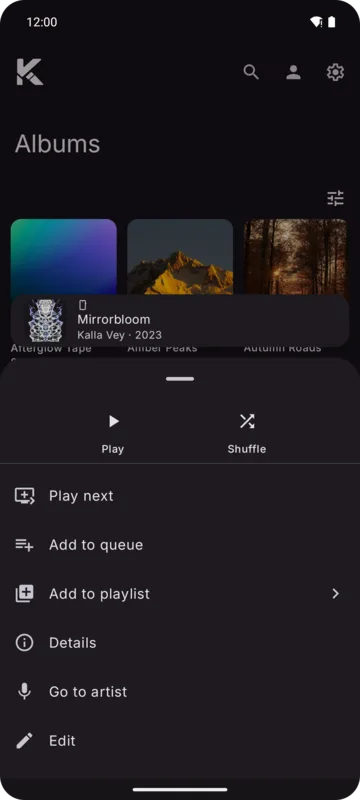
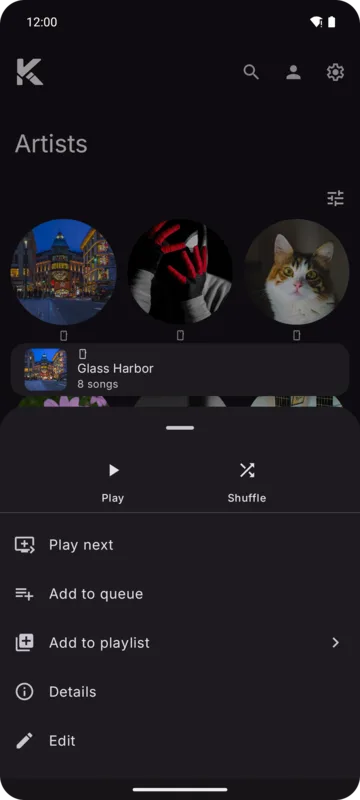
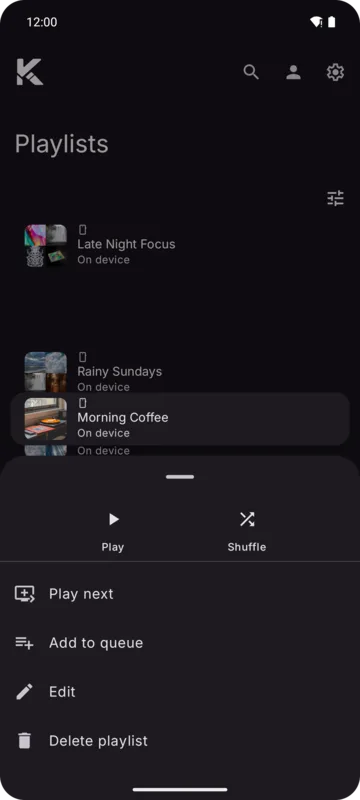

Long press a song, album, artist or playlist anywhere to open its menu. The item lifts out of the
list and the menu slides up under it. In the full player, the **more** button opens the playing
song's menu.

## Song menu

The top row:

| Button | What it does |
|--------|--------------|
| **Dislike** / **Like** | See [Likes and dislikes](./likes-and-dislikes.md) |
| **Share** | Shares the song's link (not for device songs) |
| **Download** | See below |

Then:

- **Play next**: right after the playing song (not shown in the full player).
- **Add to queue**: at the end (not shown in the full player).
- **Add to playlist**: a list of your playlists, newest first, with a button to create a new one.
  Adding a song a playlist already has tells you so.
- **Start radio**: plays songs like this one.
- **Go to album**, and the song's artists (with several, you pick one).
- **Details**: [MusicBrainz details](./details.md) of the song.
- **Edit**: [your own title, artists and cover](./editing.md).
- Actions of the list you're in, such as **Remove from playlist** or **Delete from history**.

YouTube songs found without an album or artist id look them up when you tap **Go to album** or an
artist, with a spinner while they do. Device songs whose album or artist isn't known show those
rows grayed out.

### The download button

Its label follows the song's state:

| State | Tap |
|-------|-----|
| **Download** | Downloads the song |
| **Cached** | Move the cached copy to your downloads, or remove it from the cache. If the cached copy is worse than the download quality set now, the song is downloaded again. |
| **Downloading** | Asks to stop the download |
| **Paused** | Stop, or **Resume** |
| **Downloaded** | Asks to delete the download; the song can still be streamed |

## Album, artist and playlist menus

Long press an album, artist or playlist card:

- **Play**, **Shuffle**, **Play next**, **Add to queue**
- **Add to playlist**: every song of the item
- **Share**
- **Details** (albums and artists): [MusicBrainz details](./details.md)
- **Edit**: [your own name and picture](./editing.md)
- **Delete** for playlists you can delete

  

## Page menus (⋮)

The ⋮ button on an item's own page:

| Page | Buttons | Rows |
|------|---------|------|
| Album | Play, Bookmark, Share | Shuffle, Play next, Add to queue, go to the artist, Statistics, Edit; Reorder on device albums |
| Artist | Play, Follow, Share | Shuffle, Play next, Add to queue, Details, Statistics, Edit |
| Playlist | Play next, Add to queue, Share | Move and remove switches, Edit, Delete playlist (your own playlists); Add to library (YouTube Music) |
