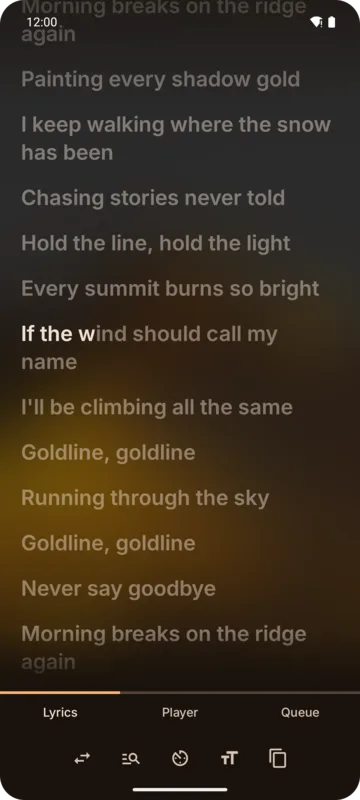

The **Lyrics** page of the full player shows the playing song's lyrics.

## Synced lyrics

When a source has timing, lyrics follow the song:

- **Word by word**: each word fills in as it's sung.
- **Line by line**: the current line lights up.

The list scrolls by itself, keeping the current line a third of the way down; drag it to look
around. **Tap a line** to jump to it.

Background vocals show as their own lines when the source marks them.

## Sources

| Source | Timing it usually has |
|--------|-----------------------|
| **LRCLIB** (default) | Plain text or line by line |
| **Better Lyrics** | Mostly word by word |
| **LyricsPlus** | Mostly word by word |
| **YouTube Music** | Plain text, for YouTube Music songs |

Kreate asks one source at a time.

## The lyrics bar

The buttons above the tabs on the Lyrics page:

| Button | What it does |
|--------|--------------|
| **Change source** | Pick another source for this song |
| **Search** | Search lyrics with your own words, when the match is wrong or missing |
| **Timing** | Show the lyrics word by word, line by line or as plain text |
| **Text size** | Smaller / bigger |
| **Copy** | Copy the lyrics |

When a source has nothing, the page says so and points at **Change source**.

## Settings

**Settings → Player → Lyrics**:

| Setting | Default | What it does |
|---------|---------|--------------|
| **Lyrics source** | LRCLIB | Where lyrics come from first |
| **Preferred timing** | Word by word | The finest timing to show; finer lyrics are shown coarser |
| **Always fetch lyrics** | Off | On: lyrics are fetched every time and never saved. Off: lyrics are saved and shown again without fetching. |
| **Text size** | 100% | Size of the lyrics text |

**Download lyrics** under **Settings → Data → Downloads** saves a song's lyrics once it's fully
downloaded, so they work offline.

A **Lyrics font** can be set under **Settings → UI → Font**.

## Picture in picture

The lyrics can follow you out of the app in a small window. See
[Picture in picture](./picture-in-picture.md).

:::note
Lyrics embedded in local files, `.lrc` files and lyrics from OpenSubsonic servers aren't read yet.
:::
