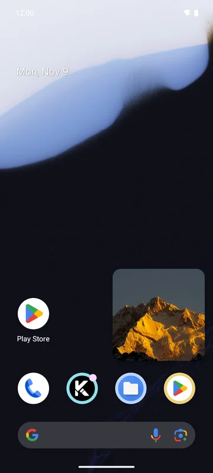
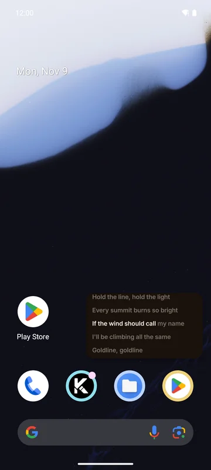

On Android 11 and newer, leaving the app while music plays can show a small floating window.

Turn it on under **Settings → General → Picture in picture**.

## What the window shows

- The **cover**, in a square window, or
- the **synced lyrics**, in a wide window, when you left the app from the Lyrics page.

 

The window has **previous**, **play/pause** and **next** buttons.

On Android 12 and newer the window opens by itself when you go home; on Android 11 it opens when you
leave the app with the home button.

## Settings

| Setting | Default | What it does |
|---------|---------|--------------|
| **Picture in picture** | Off | Leaving the app shows the cover, or the lyrics, in a small window |
| **Text size** | 50% | Lyrics text size relative to fullscreen lyrics |
