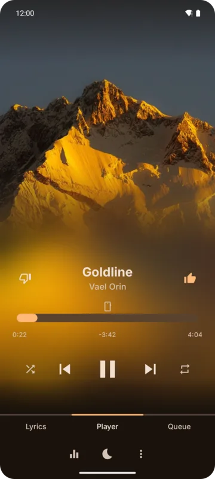

## Mini player

While something is queued, the mini player sits at the bottom of the screen with the song, its
cover and play/pause.

- **Tap** it, or **drag it up**, to open the full player.
- **Drag it down** past half its height (or fling it) to stop playback and clear the queue.

## Full player

The full player slides up over the app on a blurred copy of the cover. Drag it down to close it;
lists inside it close it too when dragged down from their top.

It has three pages, switched by the tabs at the bottom or by swiping:

| Page | What's on it |
|------|--------------|
| **Player** | Cover, title and artists, like/dislike, seek bar, previous / play-pause / next, shuffle, repeat |
| **Lyrics** | The song's lyrics, see [Lyrics](./lyrics.md) |
| **Queue** | What plays next, see [Queue](./queue.md) |

Each page has its own row of buttons above the tabs.

### Player page buttons

| Button | What it does |
|--------|--------------|
| **Equalizer** | Opens the system's audio effects panel (or an equalizer app you installed) |
| **Sleep timer** | See [Sleep timer](./sleep-timer.md). Shows the time left while it runs. |
| **More** | The playing song's [menu](../library/song-menu.md) |

### Shuffle and repeat

- **Shuffle** plays the queue in a random order. The Queue page then lists songs in the order they
  will play.
- **Repeat** cycles **off → one → all**. Repeat one and shuffle exclude each other.
- **Play next** while shuffling puts the song next in the shuffled order too.

## Radio

**Start radio** in a song's menu plays 30 songs like it:

- for YouTube Music and server songs, the source suggests them;
- for device songs, Kreate picks them from your own library.

Radio songs aren't added to your library unless you play them.

## Notification and lock screen

The media notification and lock screen controls show the cover and the usual buttons. Tapping the
notification opens the app with the full player; turn that off under
**Settings → General → Navigation → Open player from notification**.

Pressing play on headphones, or on the system's media controls, when nothing is queued picks up the
[saved queue](./playback-settings.md#keep-the-queue).

## Theme from the cover

With the **Thumbnail** theme (the default), the app's colors follow the playing song's cover. See
[Appearance](../customization/appearance.md).
