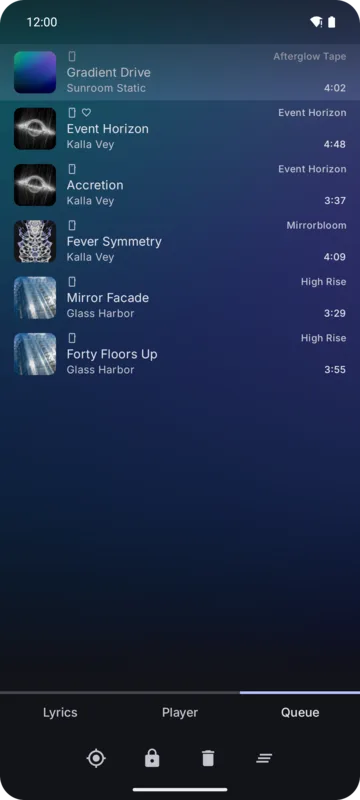

The **Queue** page of the full player lists the songs to play. Tap a song to jump to it.

## Adding songs

- **Play** a list, album, artist or playlist: replaces the queue.
- **Play next**: right after the playing song.
- **Add to queue**: at the end.

These are in every item's menu, in the tab sheets and on detail pages.

## Queue buttons

| Button | What it does |
|--------|--------------|
| **Locate** | Scrolls to the playing song |
| **Lock / reorder** | Covers become drag handles; drag songs to move them |
| **Trash** | Covers become remove buttons |
| **Clear** | Asks first, then removes every song but the one playing. Tick **Remove currently playing song** to stop the player and close the full player as well. |

While shuffle is on, moving songs isn't possible: the lock is dimmed and tapping it says
*Turn shuffle off to move songs*.

The reorder and remove modes turn off when you leave the Queue page.

## Disliked songs

Disliking a song removes it from the queue at once.

## The queue survives restarts

With **Keep the queue** on (default), the queue and where you were are saved, and come back when
the app starts again. See [Playback settings](./playback-settings.md#keep-the-queue).
