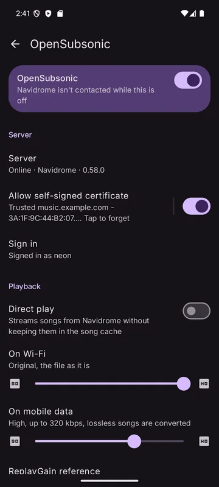
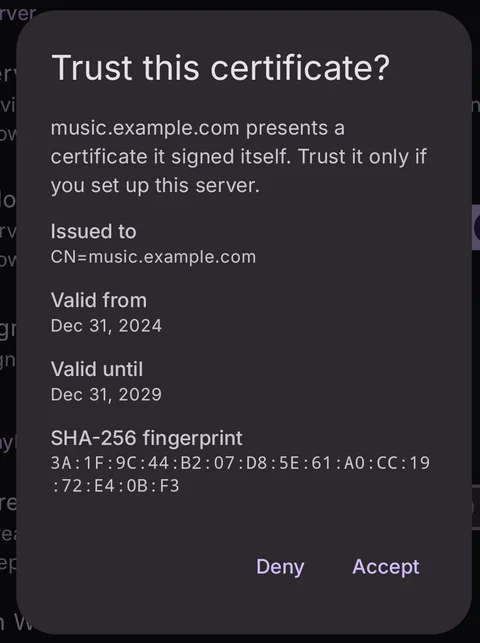

Kreate plays the music on your own server through the **OpenSubsonic** API, used by Navidrome and
other servers.

Settings: **Settings → Network → Configure OpenSubsonic**.

## Connecting

1. Turn on the page's main switch. While it's off, the server is never contacted.
2. Tap **Sign in**:
   - **Server address**, starting with `https://` or `http://`.
   - Choose **Password** (username + password) or **API key**.
3. **Save**. The row shows the result: *Signed in as …*, *Wrong username or password*,
   *Can't reach …* and so on.

Use **Sign out** on the sign-in page to remove the saved username, password and API key.

## Self-signed certificates

If your server uses a certificate it signed itself:

1. Turn on **Allow self-signed certificate**.
2. Kreate shows the certificate (issued to, valid from/until, SHA-256 fingerprint) and asks
   **Trust this certificate?** Tap **Accept** only if you set up this server; otherwise tap **Deny**.

From then on only that certificate is accepted. If the server presents a **different** one,
Kreate stops and asks again (**Certificate changed**): if you didn't replace it, someone may be
pretending to be your server. Tap the row to forget a trusted certificate.

## Sync

| Setting | Default | Choices |
|---------|---------|---------|
| **Sync songs** | On | Starred (favorite) songs mark the same songs liked in your library |
| **Sync albums** | All | Off · Liked only · All |
| **Sync artists** | All | Off · Liked only · All |
| **Sync playlists** | On | Your server playlists show in the Playlists tab |

Liking a song in Kreate stars it on the server while song sync is on. **Bookmark** an album and
**Follow** an artist also use the server's star.

## Playback

| Setting | Default | What it does |
|---------|---------|--------------|
| **Direct play** | On | Streams songs without keeping them in the song cache. When the song cache is off, songs always stream directly. |
| **On Wi-Fi** | Original | Quality on unmetered networks |
| **On mobile data** | High | Quality on metered networks |
| **ReplayGain reference** | −18 LUFS | The loudness your server's ReplayGain tags bring songs to. See [Loudness](../playback/loudness.md). |

Quality below Original is a highest bitrate: the server converts songs above it.

## Server playlists

You can reorder and remove songs, rename, change the description, make a playlist public, and
delete it. Changes are made on the page first and sent together. See
[Playlists](../library/playlists.md).

## Artist pages

A server artist's page shows its top songs (filled from search when the server has few), albums
and description. **See more** lists every song of the artist.

## Sharing

**Share** on a server song, album or playlist asks the server for a share link.
