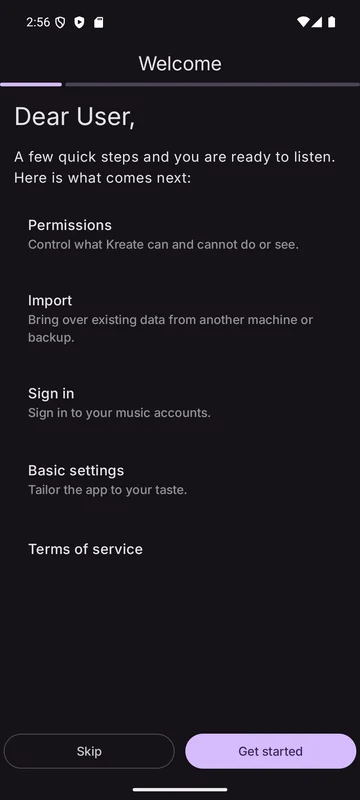
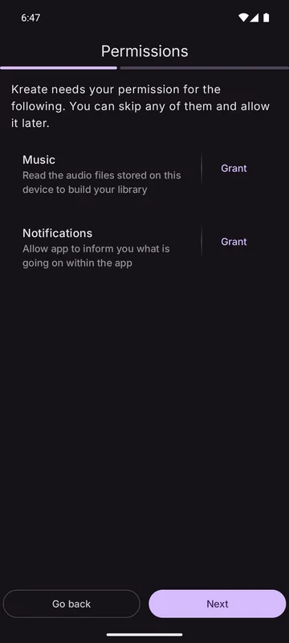
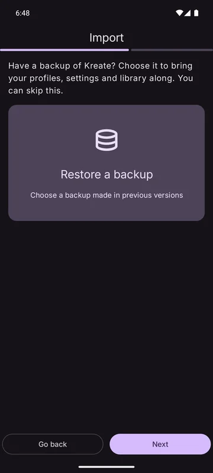
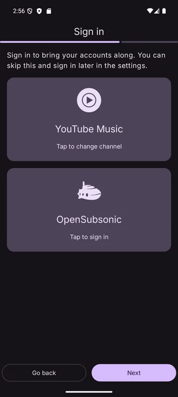
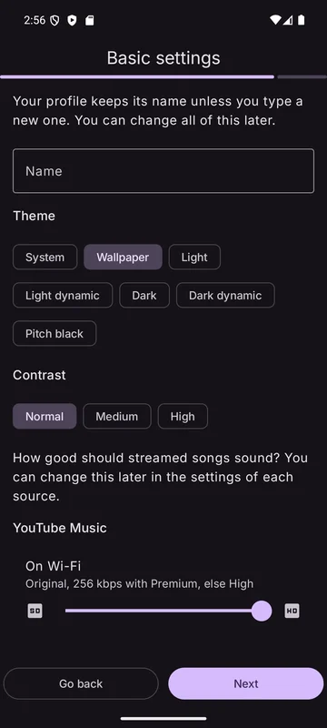
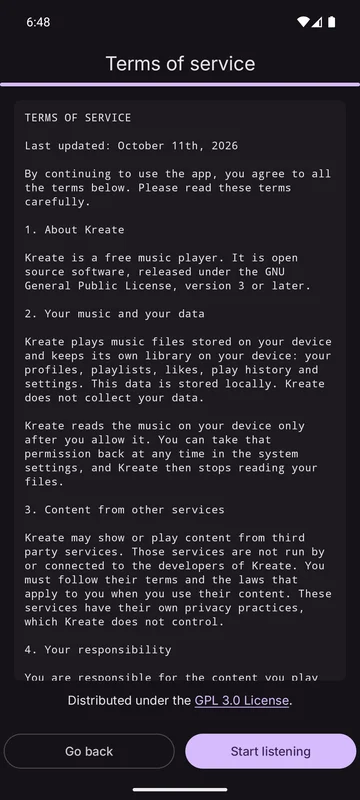

Haven't installed Kreate yet? Start with [Choosing your build](../Installation/choosing-your-build.md)
and [Installing the APK](../Installation/installing-the-apk.md).

The first time Kreate opens, a short setup wizard walks you through the basics. Every step can be
skipped and changed later in the settings.

## 1. Welcome

A summary of what comes next: permissions, import, sign-in, basic settings and the terms of service.

## 2. Permissions

| Permission | Why |
|------------|-----|
| **Music** | Read the audio files stored on this device to build your library. |
| **Notifications** | Show playback controls, download progress, scan progress and other notices. |

You can skip either one and allow it later. Without the music permission, the
[local scan](../Features/sources/local-files.md) can't run; the setting shows *Tap to allow Kreate to read
local audio files* until you do.

## 3. Import

Have a backup? Choose it to bring your profiles, settings and library along. The wizard accepts:

- a backup made by Kreate (**Settings → Backup → Back up**), and
- the export of the **old Kreate app** (see [Import from the old app](../Features/backup/import-from-old-kreate.md)).

The backup is restored once the wizard finishes. When a Kreate backup holds an OpenSubsonic
server address, the next page, Sign in, fills it in for you.

## 4. Sign in

Sign in to bring your accounts along:

- **YouTube Music**: your albums, artists, playlists and liked songs, and suggestions made for
  you. See [YouTube Music](../Features/sources/youtube-music.md).
- **OpenSubsonic**: the address of your server plus a username and password, or an API key. See
  [OpenSubsonic](../Features/sources/opensubsonic.md).

Skip it to sign in later under **Settings → Network**.

## 5. Basic settings

- **Profile name**: leave it empty to keep the default name.
- **Theme**: see [Appearance](../Features/customization/appearance.md).
- **Contrast**: Normal, Medium or High.
- **Stream quality**: how good streamed songs should sound, on Wi-Fi and on mobile data. The
  YouTube Music slider is always shown; its top step becomes *Original* once you're signed in. The
  OpenSubsonic sliders show only once you've signed in to a server.

A restored Kreate backup already carries its profiles, so this page is skipped.

## 6. Terms of service

Read and accept the terms, then **Start listening**.

:::tip
Nothing in the wizard is final. Every choice has a matching row in **Settings**.
:::
