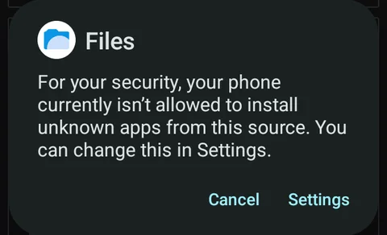
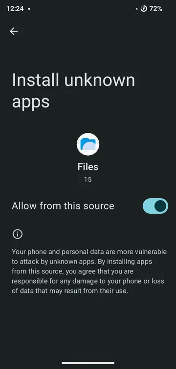
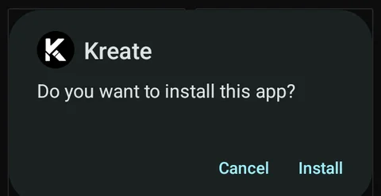
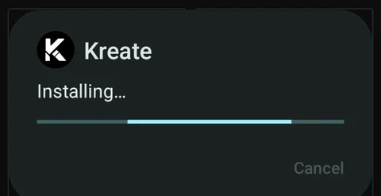
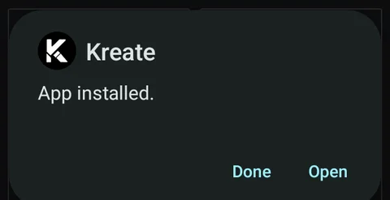

This page is for APKs you download yourself, from GitHub or Patreon. F-Droid and IzzyOnDroid
install Kreate for you; follow your store's prompts instead.

Not sure which APK to download? See [Why are there multiple APKs?](/usr/faq/multiple-apks).

The screens below come from one phone. Yours may look a little different, but the steps are the
same.

## 1. Open the APK

Open the downloaded file, from your browser's downloads or a file manager.

The first time you install an app from that browser or file manager, Android blocks it:

Tap **Settings**.

## 2. Allow installing from this source

Turn on **Allow from this source**, then go back.

This only allows the app you opened the APK with (here, Files) to install apps. You can turn it off
again once Kreate is installed; updates from Kreate's built-in updater ask separately.

## 3. Install

Android asks whether you want to install Kreate. Tap **Install**.

:::note[Google Play Protect]
Play Protect may ask to scan Kreate before installing it. You can skip the scan; Kreate installs
either way. Allowing the scan is completely fine too.
:::

## 4. Open Kreate

Tap **Open** to start Kreate. The [setup wizard](../Getting-started/first-launch.md) walks you
through the rest.

## Something went wrong?

- **App not installed as app isn't compatible with your phone**: the APK is for a different
  processor. Download `kreate-universal.apk`; see
  [Why are there multiple APKs?](/usr/faq/multiple-apks).
- **App not installed as package conflicts with an existing package**: another Kreate build is
  already installed. See [Switching between builds](./choosing-your-build.md#switching-between-builds).
- Not sure the APK is genuine? [Verify it](/verify) before installing.
