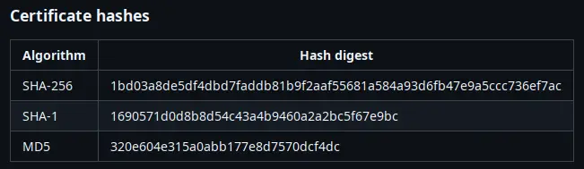

Every official Kreate APK is signed by its maintainer, [knighthat](https://github.com/knighthat).
Verifying that signature is the most reliable way to tell whether anyone has tampered with the app,
especially if you didn't download it from an [official source](/download).

:::tip[TL;DR]

Open **[Verify APK](/verify)**, drop your `.apk` file in, and only install it if you see a green tick.

:::

## ❓ Why?

An APK's signature matters for three reasons:

1. 🛡️ **App integrity**: any change made to the APK after it was signed breaks the signature.
   Nobody can add malware to a signed APK without it showing. [Learn more about APK signing](https://developer.android.com/studio/publish/app-signing)
2. 👤 **Developer identity**: only the holder of the private key can produce a valid signature,
   while anyone can check it with the matching public certificate. If the certificate matches
   the official one, the APK came from Kreate's maintainer.
3. ⏫ **Update verification**: Android only installs an update if it is signed with the same key
   as the app already installed, which stops anyone else from pushing "updates" to you.

:::note

Because of point 3, an APK re-signed by someone else's key can't be installed over an official Kreate APK,
even though both have the same app ID.

:::

## ✅ Verify in your browser (recommended)

The [Verify APK](/verify) page checks the signature for you.

1. Download Kreate from the [download page](/download).
2. Open [Verify APK](/verify).
3. Drag the `.apk` file onto the box, or click it and pick the file.
4. Read the result:
   * ✅ **Genuine Kreate APK**: the file is signed with the official certificate and hasn't been modified. It's safe to install.
   * ❌ **Not a genuine Kreate APK**: the signature is broken, missing, or belongs to someone else. **Don't install it.**

:::info[Your file never leaves your device]

The whole check runs inside your browser. The APK is never uploaded.

After a file passes, the page also shows the app's version, permissions and bundled libraries, and looks up the file's
[VirusTotal](https://www.virustotal.com) report. Only the file's SHA-256 hash is sent for that lookup, never the file itself.

:::

APKs from GitHub releases, IzzyOnDroid and F-Droid are all signed with the official certificate,
so they should all pass.

## 🛠️ Verify manually

If you'd rather not use a browser, or want to double-check, you can verify the APK yourself with `apksigner` or `keytool`.
Either way, you compare the APK's **certificate SHA-256** with the official one:

```text
1bd03a8de5df4dbd7faddb81b9f2aaf55681a584a93d6fb47e9a5ccc736ef7ac
```

The same value is listed under **Official signing certificate** on the [Verify APK](/verify) page and in the
`Verification` section of each release post.



### 🫆 With `apksigner`

`apksigner` is Google's tool for signing and verifying APKs. It is the most thorough check, because it verifies
every signature scheme. It ships with the Android SDK build tools; follow
[How to install build tools](/dev/guides/how-to-install-buildtools) to get it without installing Android Studio.

Once installed, `apksigner` is at `[sdk_root]/build-tools/35.0.0/apksigner`. Run:

* Linux/Mac
  ```sh
  [sdk_root]/build-tools/35.0.0/apksigner verify --print-certs -v /path/to/Kreate.apk
  ```
* Windows
  ```sh
  [sdk_root]\build-tools\35.0.0\apksigner verify --print-certs -v C:\path\to\Kreate.apk
  ```

The output starts like this:

```sh
Verifies
Verified using v1 scheme (JAR signing): true
Verified using v2 scheme (APK Signature Scheme v2): true
Verified using v3 scheme (APK Signature Scheme v3): true
...
Number of signers: 1
Signer #1 certificate DN: C=US, ST=Texas, L=Houston, O=KnightHat, OU=Kreate, CN=Tan Nguyen
Signer #1 certificate SHA-256 digest: 1bd03a8de5df4dbd7faddb81b9f2aaf55681a584a93d6fb47e9a5ccc736ef7ac
...
```

Check that:

* the first line is `Verifies`,
* `Number of signers` is `1`,
* `Signer #1 certificate SHA-256 digest` matches the official value above.

### 🗝️ With Java's `keytool`

`keytool` comes with every Java installation, so it's often easier to get. If you don't have Java yet, follow
[How to install Java 21](/dev/guides/how-to-install-java-21).

:::warning

`keytool` only prints the certificate. It does **not** check that the APK's content still matches the signature,
so a tampered file can still show the right certificate. Prefer [Verify APK](/verify) or `apksigner` when you can.

:::

Open a terminal (Command Prompt on Windows) and run:

```sh
keytool -printcert -v -jarfile /path/to/Kreate.apk
```

You'll see something like:

```sh
Signer #1:

Certificate #1:
Owner: C=US, ST=Texas, L=Houston, O=KnightHat, OU=Kreate, CN=Tan Nguyen
...
Certificate fingerprints:
         SHA1: 16:90:57:1D:0D:8B:8D:54:C4:3A:4B:94:60:A2:A2:BC:5F:67:E9:BC
         SHA256: 1B:D0:3A:8D:E5:DF:4D:BD:7F:AD:DB:81:B9:F2:AA:F5:56:81:A5:84:A9:3D:6F:B4:7E:9A:5C:CC:73:6E:F7:AC
```

`keytool` prints the same hash in a different format: uppercase, with a colon between every pair of characters.
Remove the colons and lowercase it, and the `SHA256` line should match the official value above.

## 🚨 If verification fails

:::danger[Don't install the APK if you see]

* ❌ "Not a genuine Kreate APK" on the [Verify APK](/verify) page
* More than one signer
* A certificate hash that doesn't match the official one

Delete the `.apk` right away, download a fresh copy from the [download page](/download),
and [report where you got it](https://github.com/knighthat/Kreate/issues).

:::
